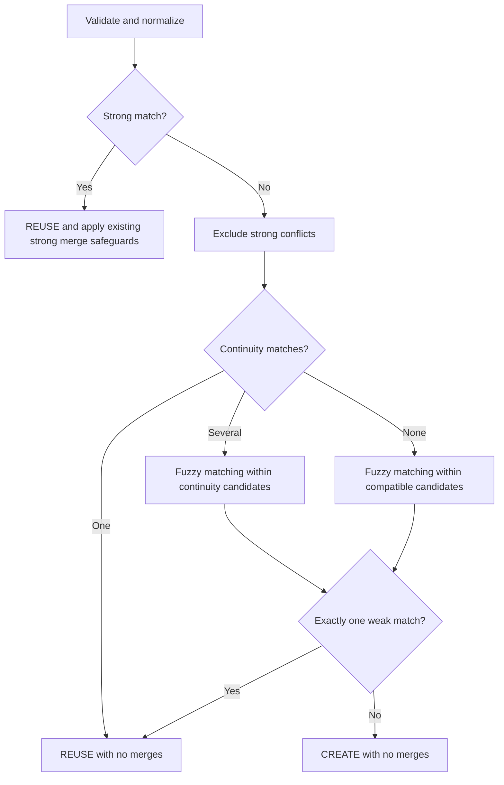

# How Asset Identity Works

Asset-identity decides whether an observation should use an existing asset key or receive a new one. It combines
identifier normalization, configurable strong-ID priority, continuity, and weak evidence. The native Go API and the GLib C API run
the same algorithm.

This document explains the current library through examples. The [specifications](specs/SPEC-001-identifiers.md)
define the detailed contracts.

## 1. The decision in one example

An application supplies an observation and the existing assets it wants considered:

| Input       | Agent ID | IP         | Existing asset key |
|-------------|----------|------------|--------------------|
| Observation | agent-42 | 192.0.2.20 | —                  |
| Candidate   | agent-42 | 192.0.2.10 | asset-A            |

The Agent ID matches, so the result is `REUSE asset-A`. The IP change does not prevent this continuity match.

The library returns this decision. The application assigns or generates the key and stores its own data. It also returns
eligible existing keys to move under the destination key. The application performs those moves.

## 2. What goes into the algorithm

| Concept     | Meaning                                                                         |
|-------------|---------------------------------------------------------------------------------|
| Observation | The eligible active identifiers describing the newly observed asset             |
| Candidate   | An existing asset key, its eligible active identifiers, and optional `LastSeen` |
| Identifier  | A type and a value                                                              |
| Policy      | Strong priority, continuity membership, and fuzzy types/weights              |

One observation or candidate can contain several identifier types and several values of each type. For example, a host
may have two IP addresses, several SSH keys, and multiple TLS certificates.

The application finds candidates before calling the library. It also decides which scanner, network, tenant, historical
values, and producer data are eligible. The library compares exactly the supplied views; it does not discover hosts,
query a database, or build candidates from past observations. You can collect candidates by any equal hostname, IP, or
MAC. Supply one candidate per existing key, with its complete eligible active identifiers, rather than only the
identifier that matched the query. Otherwise weak-evidence and strong-ID safeguards would operate on incomplete data.

### Identifiers compare by type and canonical value

```text
identifier = (type, canonical value)
```

## 3. Default identifier roles

`GreenboneMatchPolicy()` defines the following strong priority, highest first:

| Priority | Identifier          | Matching rule                  |
|----------|---------------------|--------------------------------|
| 1        | Cloud identifier    | Any equal value                |
| 2        | Greenbone ID        | Any equal value                |
| 3        | Machine ID          | Any equal value                |
| 4        | BIOS UUID           | Any equal value                |

Reuse an existing key when its highest-priority shared strong type matches. Missing stronger IDs allow a lower match; a
stronger shared conflict blocks it. New evidence enriches the reused asset without replacing its key.

Continuity types are Agent ID, SSH host key, and TLS public-key hash. Any one shared eligible value can identify a
unique compatible candidate. No continuity type outranks another.

The default fuzzy types are:

| Identifier | Weight |
|------------|--------|
| MAC        | 1.0    |
| Hostname   | 0.4    |
| IP         | 0.4    |
| FQDN       | 0.4    |

FQDN is weak evidence because names can be reassigned or shared. Compare the full normalized name:
`SERVER.EXAMPLE.COM.` and `server.example.com` match as FQDNs. Hostname and FQDN remain different types;
`hostname:server` does not match `fqdn:server.example.com`. FQDN participates in weak matching and merge eligibility
alongside the other configured fuzzy types.

Callers may reorder, omit, or reclassify supported types. A type cannot belong to more than one stage. An omitted type does not
contribute to matching. Empty configuration does not restore defaults.

## 4. Normalize before comparing

Normalization makes equivalent representations comparable without changing caller-owned inputs.

| Input                                              | Canonical value used for matching      |
|----------------------------------------------------|----------------------------------------|
| MAC `02-AB-CD-EF-01-23`                            | `02:ab:cd:ef:01:23`                    |
| IP `2001:0DB8:0:0:0:0:0:1`                         | `2001:db8::1`                          |
| Hostname `WEB.Example.`                            | `web.example`                          |
| IP `::ffff:192.0.2.1`                              | `192.0.2.1`                            |
| BIOS UUID `{00112233-4455-6677-8899-AABBCCDDEEFF}` | `00112233-4455-6677-8899-aabbccddeeff` |
| SSH `22 ecdsa-sha2-nistp256 <key>`                 | `ecdsa-sha2-nistp256 <canonical-key>`  |
| TLS `x509:<base64-DER-certificate>`                | `spki-sha256:<public-key-digest>`      |

Every type has its own normalizer and surrounding whitespace is trimmed. Greenbone, agent, and cloud IDs and image
references keep their case. Placeholders such as `127.0.0.1`, `00:00:00:00:00:00`, a zero BIOS UUID, or
`localhost` identify no single machine: normalization reports them as invalid, and matching leaves them out instead of
failing. A machine ID is accepted as the 32 hex digits of a Linux machine-id or as the UUID of a Windows MachineGuid,
with or without braces; both forms canonicalize to the same 32 hex digits.

### Raw SSH and TLS values

The caller may pass the SSH scanner value, including its leading port, directly. The port and optional key comment are
removed; public-key material determines equality.

For TLS, the library decodes the `x509:` certificate, extracts its exact DER SubjectPublicKeyInfo, and calculates
SHA-256 internally. Existing `spki-sha256:` values are also accepted. Callers do not need to calculate the hash.

This means:

- A renewed certificate with the same public key has the same TLS identifier, assuming the same SPKI encoding.
- The same public key presented on two ports contributes one distinct TLS identifier.
- A certificate with a different public key contributes a different TLS identifier.
- Issuer CN, serial number, validity dates, and whole-certificate fingerprints cannot replace the public-key input.

Certificate trust, signatures, and expiry are not checked. An `x509:` certificate takes part in matching only when its
subject CN or a DNS SAN equals an FQDN or hostname identifier in the same view, compared case-insensitively without a
trailing dot; wildcard names never match. Other certificates are left out. Certificate names are not converted into FQDN
identifiers, and there is no `tls_fqdn_cn` identifier type.

`Decide` performs normalization automatically. Structural model `Validate` methods alone do not validate payload syntax;
standalone `ValidateIdentifier`, `NormalizeIdentifier`, and `EqualIdentifiers` are available when needed. Full format
rules are in [SPEC-001B](specs/SPEC-001B-normalization.md).

## 5. Four steps

1. **Strong:** use the highest-priority shared machine identity. A strong conflict excludes that candidate from later stages.
2. **Continuity:** if no strong match wins, reuse one compatible record sharing an Agent ID, SSH key, or TLS key.
3. **Fuzzy:** with several continuity matches, compare only those records. With none, compare all records without a
   strong conflict. Keep the issue #11 weak rules and require exactly one qualifying candidate. Otherwise `CREATE`.
4. **Merging:** only a strong-stage decision may merge related records. Continuity and fuzzy reuse return no merge indices.



The application creates keys, stores incoming evidence, retains history, and applies permitted moves atomically.

## 6. Choose a key using strong IDs

### Reuse and enrich an existing key

In the Go API, the incoming record is the `Observation`; `Candidate` means an existing record. Machine ID has higher
priority than continuity evidence:

| Incoming observation | Existing candidates        | Stage      | Result         | Merge indices |
|----------------------|----------------------------|------------|----------------|---------------|
| Machine X, Agent A   | K0: Agent A                | CONTINUITY | REUSE K0       | `[]`          |
| Agent A              | K0: Machine X, Agent A     | CONTINUITY | REUSE K0       | `[]`          |
| Machine X, Agent A   | K0: Machine Y, Agent A     | FUZZY      | CREATE new key | `[]`          |
| Machine X, Agent B   | K0: Machine X, Agent A     | STRONG     | REUSE K0       | `[]`          |
| Machine X, Agent A   | K0: Agent A; K1: Machine X | STRONG     | REUSE K1       | `[0]`         |

Compare the highest-priority strong type present on both sides. Missing types are skipped; a shared conflict blocks that
record. Differences below a matching type do not veto it. The same rules follow a custom policy's order.

When Agent A matches but the stored record lacks Machine X, continuity reuses its key and the caller stores the incoming evidence.
This keeps the key stable as more identifiers are discovered. Conflicting Machine IDs remain separate. The application
retains prior evidence according to its history policy and applies any merge moves atomically.

### If several candidates match the same strong type

Among eligible candidates, prefer the highest-priority shared strong match. One equal value of that type is enough.
Multiple values can match several candidates at that priority.

Choose the candidate with the newest `LastSeen`. Present timestamps rank before missing timestamps; equal or all-missing
times use the smallest asset key in byte order. Strong timestamps include nanoseconds. This chooses one destination. The
separate merge rules decide whether other records can join it.

### Continuity after a strong match is unavailable

A unique shared Agent ID, SSH key, or TLS key returns `CONTINUITY REUSE`. Differences in other continuity types or weak
identifiers do not veto it. A strong conflict still blocks the candidate.

TLS requires only one shared eligible public key:

| Incoming keys | Stored keys | Continuity? |
|---------------|-------------|-------------|
| A, B          | B, A        | Yes         |
| A, B          | A           | Yes         |
| A, B          | A, C        | Yes         |
| A, B          | C, D        | No          |

If several records share continuity evidence, try weak matching only among those records. Do not merge them. If no key
survives rotation, try weak evidence among candidates without strong conflicts.

## 7. Choose a key using weak evidence

Compare the configured weak identifiers: MAC, hostname, IP, and FQDN by default.

A compatible candidate shares at least one value. Missing types are allowed. If both sides supply a MAC or name type,
they must share a value of that type. Different IPs are allowed when a MAC matches.

**Reuse only when exactly one candidate qualifies.** Otherwise return `CREATE`. Neither timestamps nor scores choose
between multiple compatible candidates. Fuzzy decisions never merge existing records.

| Incoming identifiers | Stored identifiers   | Result with one candidate               |
|----------------------|----------------------|-----------------------------------------|
| IP P                 | IP P, FQDN F, MAC M  | REUSE                                   |
| IP P, FQDN F, MAC M  | IP P                 | REUSE; missing data is allowed          |
| IP P2, FQDN F, MAC M | IP P1, FQDN F, MAC M | REUSE; MAC supports the IP change       |
| IP P2, MAC M         | IP P1, MAC M         | REUSE                                   |
| IP P2, FQDN F        | IP P1, FQDN F        | CREATE; changed IP without a shared MAC |
| IP P, MAC M2         | IP P, MAC M1         | CREATE; conflicting MACs                |
| IP P, hostname H2    | IP P, hostname H1    | CREATE; conflicting names               |

The application supplies correctly scoped, active identifiers and retires reassigned IPs from matching. An IP-only scan
cannot identify an address reassignment when only the old asset lists that IP. If multiple assets qualify, creating a
separate record can increase the count until better evidence is available.

## 8. The returned decision

### The destination key

| Action | NeedsNewKey | SelectedKey / SelectedIndex                               |
|--------|-------------|-----------------------------------------------------------|
| REUSE  | false       | Existing destination key and its original candidate index |
| CREATE | true        | Absent; the application generates the destination key     |

`Stage` tells you whether strong, continuity, or fuzzy matching chose the destination. Go represents an absent index as nil; C uses
`has_selected_index = FALSE`.

### The records that can join it

`MergeIndices` lists positions in the original candidate array. Retrieve each candidate from that array to find its
identifiers and asset key. The selected destination is excluded. An empty list means there are no existing records to
move. The library does not return copies of candidates or individual historical observations.

Continuity and fuzzy decisions always have empty `MergeIndices`. The following merge rules apply only to strong-stage decisions.

Use the stored selected candidate as the destination. Incoming evidence can link related records. The merge safeguards
keep the previous ordering: strong types followed by continuity types.

| Source and destination  | Requirement to merge                                                                                     |
|-------------------------|----------------------------------------------------------------------------------------------------------|
| Both have strong or continuity IDs | Match the source's highest-priority type in the destination or, for strong `REUSE`, in the incoming view |
| Either lacks strong and continuity IDs | Every source fuzzy identifier occurs in the destination's nonempty fuzzy set                             |

For example, incoming Machine X + Agent A can select a Machine-X-only key and merge an Agent-A-only record into it.
Check each view separately; partial TLS sets cannot be combined into a match. A source whose strongest type is unknown
to both views stays separate.

For strong `REUSE`, exclude incoming conflicts above the selecting priority, and stored-destination conflicts at or
above it. Lower-priority differences may follow a higher strong match. Weak containment still uses the stored destination on `REUSE`; an
empty source fuzzy set is contained by any nonempty destination fuzzy set.

### Example: a strong match links related records

| Input       | Identifiers       | Existing key |
|-------------|-------------------|--------------|
| Observation | Machine X, Agent A | —           |
| Candidate 0 | Machine X         | key-1        |
| Candidate 1 | Agent A           | key-2        |

Machine X selects key-1. The incoming observation links Agent A to that identity, so the existing strong-stage merge
rules allow candidate 1 to join it:

```text
Action: REUSE
Stage: STRONG
SelectedIndex: 0
SelectedKey: key-1
MergeIndices: [1]
```

A conflicting Machine ID on candidate 1 prevents this merge. Without a strong match, Agent A could select a key through
continuity, but that decision would not merge other records. Strong-stage weak containment and TLS merge safeguards
remain unchanged; overlapping service keys alone do not authorize consolidation.

Go callers retrieve the supplied candidates directly:

```go
for _, index := range decision.MergeIndices {
source := candidates[index]
// Move source.AssetKey to the destination key in the application's transaction.
}
```

C callers use the same indices with their original `GPtrArray`:

```c
for (guint i = 0; i < decision->merge_indices->len; i++) {
    gsize index = g_array_index(decision->merge_indices, gsize, i);
    const gvm_asset_identity_candidate_t *source = g_ptr_array_index(candidates, index);
    /* Move source->asset_key to the destination key in the application's transaction. */
}
```

Keep the original candidate array available while resolving indices. The decision owns its C `merge_indices`
array, including when empty. Release it with the parent using `gvm_asset_identity_decision_free`.

Invalid policy, malformed identifiers, empty/duplicate candidate keys, or out-of-range timestamps return an error.
Invalid input is not interpreted as `CREATE`; validation covers every supplied candidate.

## 9. Calling from Go or C

Go calls:

```go
decision, err := identity.Decide(observation, candidates, identity.GreenboneMatchPolicy())
```

C calls:

```c
gvm_asset_identity_decide(observation, candidates, policy, &decision, &error);
```

C callers can pass raw `22 <algorithm> <key>` and `x509:<base64-DER-certificate>` values in identifiers on either side.
The constructor copies the supplied value; parsing occurs during `gvm_asset_identity_decide`. A malformed value produces
`GVM_ASSET_IDENTITY_ERROR_INVALID_INPUT` rather than a partial result. Use the matching free functions for owned C
objects; `decide` borrows inputs and returns an independent result. See
the [README](../README.md#c-build-test-and-install) for a complete build and usage example.

## 10. Applying the result

The application handles the decision conceptually as follows:

```text
if the call returned an error:
    do not apply a decision
else if action is REUSE:
    use the selected existing asset key
else if action is CREATE:
    generate a new asset key

in one transaction:
    store the observation using that destination key
    for each index in MergeIndices:
        move candidates[index].AssetKey to the destination key
```

The library returns the plan; the application performs the database updates. The library does not count assets, prune
history, or infer a current view from accumulated history. Changes to IPs or other identifiers only affect the next call
through the inputs supplied by the application. No key is generated inside `Decide`.

## 11. Implementation and further reading

| Topic                                          | Source or contract                                       |
|------------------------------------------------|----------------------------------------------------------|
| Input validation and decision assembly         | [reconciliation.go](../identity/reconciliation.go)       |
| Strong matching, TLS set equality, and ranking | [matching.go](../identity/matching.go)                   |
| Merge eligibility and source collection        | [merging.go](../identity/merging.go)                     |
| Weak evidence and scoring                      | [fuzzy.go](../identity/fuzzy.go)                         |
| Default policy and policy validation           | [policy.go](../identity/policy.go)                       |
| TLS certificate parsing                        | [normalization_tls.go](../identity/normalization_tls.go) |
| SSH key parsing                                | [normalization_ssh.go](../identity/normalization_ssh.go) |
| C API and ownership                            | [Public header](../include/gvm_asset_identity.h)         |
| Detailed reconciliation contract               | [SPEC-002](specs/SPEC-002-reconciliation.md)             |
