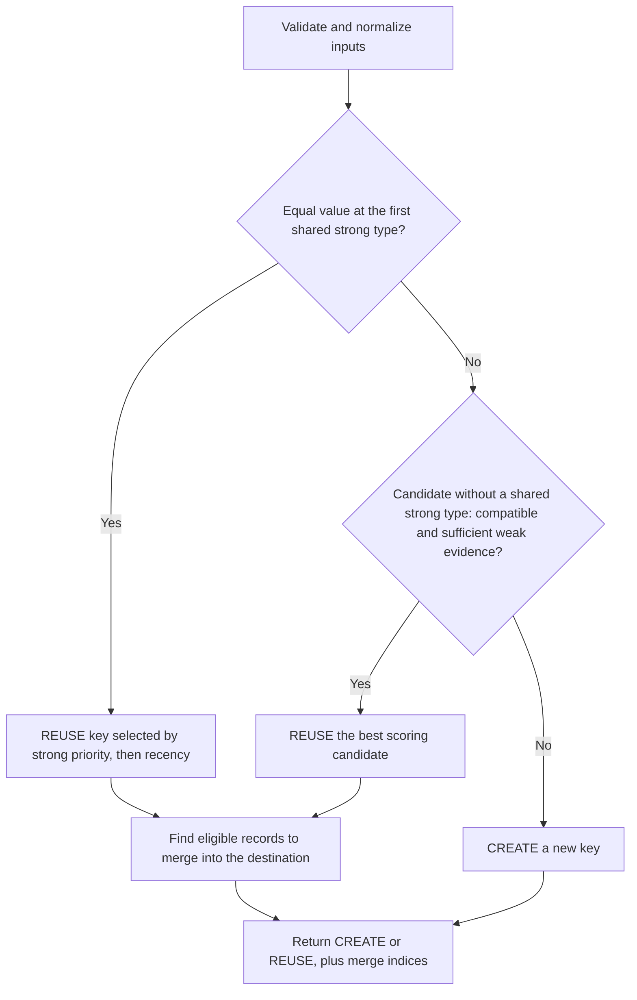

# How Asset Identity Works

Asset-identity decides whether an observation should use an existing asset key or receive a new one. It combines
identifier normalization, configurable strong-ID priority, and weighted weak evidence. The native Go API and the GLib C
API run the same algorithm.

This document explains the current library through examples. The [specifications](specs/SPEC-001-identifiers.md)
define the detailed contracts.

## 1. The decision in one example

An application supplies an observation and the existing assets it wants considered:

| Input       | Agent ID | IP         | Existing asset key |
|-------------|----------|------------|--------------------|
| Observation | agent-42 | 192.0.2.20 | —                  |
| Candidate   | agent-42 | 192.0.2.10 | asset-A            |

The Agent ID matches, so the result is `REUSE asset-A`. The IP change does not prevent a strong match.

The library returns this decision. The application assigns or generates the key and stores its own data. It also returns
eligible existing keys to move under the destination key. The application performs those moves.

## 2. What goes into the algorithm

| Concept     | Meaning                                                                         |
|-------------|---------------------------------------------------------------------------------|
| Observation | The eligible active identifiers describing the newly observed asset             |
| Candidate   | An existing asset key, its eligible active identifiers, and optional `LastSeen` |
| Identifier  | A type, a value, and an optional scope                                          |
| Policy      | Ordered strong identifier types and configured fuzzy types/weights              |

One observation or candidate can contain several identifier types and several values of each type. For example, a host
may have two IP addresses, several SSH keys, and multiple TLS certificates.

The application finds candidates before calling the library. It also decides which scanner, network, tenant, historical
values, and producer data are eligible. The library compares exactly the supplied views; it does not discover hosts,
query a database, or build candidates from past observations. You can collect candidates by any equal hostname, IP, or
MAC. Supply one candidate per existing key, with its complete eligible active identifiers, rather than only the
identifier that matched the query. Otherwise weak-evidence and strong-ID safeguards would operate on incomplete data.

### Scope is part of the identifier

A normalized identifier is compared using all three components:

```text
identifier = (type, canonical value, complete scope)
```

| Left identifier             | Right identifier           | Equal? |
|-----------------------------|----------------------------|--------|
| IP 192.0.2.10, network=A    | IP 192.0.2.10, network=A   | Yes    |
| IP 192.0.2.10, network=A    | IP 192.0.2.10, network=B   | No     |
| IP 192.0.2.10, absent scope | IP 192.0.2.10, empty scope | No     |

Scope names and values are exact; map order does not matter. Absent scope is not a wildcard. Scanner/network eligibility
remains application-owned even when identifiers carry scope.

## 3. Default identifier roles

`GreenboneMatchPolicy()` defines the following strong priority, highest first:

| Priority | Identifier          | Matching rule                  |
|----------|---------------------|--------------------------------|
| 1        | Cloud identifier    | Any equal value                |
| 2        | Greenbone ID        | Any equal value                |
| 3        | Machine ID          | Any equal value                |
| 4        | BIOS UUID           | Any equal value                |
| 5        | Agent ID            | Any equal value                |
| 6        | SSH host key        | Any equal public key           |
| 7        | TLS public-key hash | Equal complete public-key sets |

A value that differs at a higher type both views carry excludes the candidate; a type only one view carries is skipped.

The default fuzzy types are:

| Identifier | Weight |
|------------|--------|
| MAC        | 1.0    |
| Hostname   | 0.4    |
| IP         | 0.4    |
| FQDN       | 0.4    |

FQDN is weak evidence because names can be reassigned or shared. Compare the full normalized name:
`SERVER.EXAMPLE.COM.` and `server.example.com` match as FQDNs. Hostname and FQDN remain different types;
`hostname:server` does not match `fqdn:server.example.com`. FQDN participates in weak matching and merge eligibility
alongside the other configured fuzzy types.

Callers may reorder, omit, or reclassify supported types. A type cannot belong to both stages. An omitted type does not
contribute to matching. Empty configuration does not restore defaults.

## 4. Normalize before comparing

Normalization makes equivalent representations comparable without changing caller-owned inputs.

| Input                                              | Canonical value used for matching      |
|----------------------------------------------------|----------------------------------------|
| MAC `02-AB-CD-EF-01-23`                            | `02:ab:cd:ef:01:23`                    |
| IP `2001:0DB8:0:0:0:0:0:1`                         | `2001:db8::1`                          |
| Hostname `WEB.Example.`                            | `web.example`                          |
| IP `::ffff:192.0.2.1`                              | `192.0.2.1`                            |
| BIOS UUID `{00112233-4455-6677-8899-AABBCCDDEEFF}` | `00112233-4455-6677-8899-aabbccddeeff` |
| SSH `22 ecdsa-sha2-nistp256 <key>`                 | `ecdsa-sha2-nistp256 <canonical-key>`  |
| TLS `x509:<base64-DER-certificate>`                | `spki-sha256:<public-key-digest>`      |

Every type has its own normalizer and surrounding whitespace is trimmed. Greenbone, agent, and cloud IDs keep their
case. Placeholders such as `127.0.0.1`, `00:00:00:00:00:00`, a zero BIOS UUID, or
`localhost` identify no single machine: normalization reports them as invalid, and matching leaves them out instead of
failing. Machine IDs require
`Scope["kind"]` to select Linux machine-ID or Windows MachineGuid parsing. Scopes are copied and preserved, rather than
inferred from payloads.

### Raw SSH and TLS values

The caller may pass the SSH scanner value, including its leading port, directly. The port and optional key comment are
removed; public-key material determines equality.

For TLS, the library decodes the `x509:` certificate, extracts its exact DER SubjectPublicKeyInfo, and calculates
SHA-256 internally. Existing `spki-sha256:` values are also accepted. Callers do not need to calculate the hash.

This means:

- A renewed certificate with the same public key has the same TLS identifier, assuming the same SPKI encoding and scope.
- The same public key presented on two ports contributes one distinct TLS identifier when scopes are equal.
- A certificate with a different public key contributes a different TLS identifier.
- Issuer CN, serial number, validity dates, and whole-certificate fingerprints cannot replace the public-key input.

Certificate trust, signatures, and expiry are not checked. An `x509:` certificate takes part in matching only when its
subject CN or a DNS SAN equals an FQDN or hostname identifier in the same view, compared case-insensitively without a
trailing dot; wildcard names never match. Other certificates are left out. Certificate names are not converted into
FQDN identifiers, and there is no `tls_fqdn_cn` identifier type.

`Decide` performs normalization automatically. Structural model `Validate` methods alone do not validate payload syntax;
standalone `ValidateIdentifier`, `NormalizeIdentifier`, and `EqualIdentifiers` are available when needed. Full format
rules are in [SPEC-001B](specs/SPEC-001B-normalization.md).

## 5. Four steps

The algorithm first chooses the destination key, then finds existing records that can move under it.

1. **Look for a strong match.** For each candidate, take the first strong type both views carry: an equal value is a
   match, a different value excludes the candidate. TLS key sets that differ are inconclusive and the next type decides.
   The match at the highest priority selects an existing key: `REUSE`.
2. **Compare weak evidence when strong comparison is unavailable.** Candidates that share no strong type with the
   observation are compared on the configured fuzzy types. A compatible candidate with sufficient shared evidence is
   reused; the best score wins.
3. **Otherwise create.** Return `CREATE` when no candidate qualifies.
4. **Find records that can join the destination.** Apply the merge rules below and return their indices.

Here, “strong” and “fuzzy” mean the types enabled in the supplied policy. The defaults are listed above.
`CREATE` requests a new key from the application; the library does not generate one.



Invalid input returns an error before a decision can be applied.

## 6. Choose a key using strong IDs

### Try identifier types in order

For each candidate, look at the first configured strong type both the observation and the candidate carry. An equal
value is a match at that type's priority; a different value excludes the candidate. A type only one side carries is
skipped. Among all matching candidates, the highest priority wins.

For example, Greenbone ID has higher priority than Agent ID:

| Incoming observation       | Existing candidates                        | Destination   |
|----------------------------|--------------------------------------------|---------------|
| Greenbone ID G, Agent ID A | asset-G matches G; newer asset-A matches A | REUSE asset-G |
| Greenbone ID G, Agent ID A | Nobody matches G; asset-A matches A        | REUSE asset-A |
| Agent ID A, changed IP     | asset-A matches A and has the old IP       | REUSE asset-A |
| Agent ID A, IP P           | Nobody matches A; asset-B matches only P   | CREATE        |
| Agent ID A, IP P, MAC M    | asset-B has no strong ID; matches P and M  | REUSE asset-B |
| Agent ID A, Machine ID X   | asset-C has Agent ID A and Machine ID Y    | CREATE        |

**Priority comes before recency.** A newer Agent-ID match cannot beat a Greenbone-ID match. A Greenbone ID only one
side carries is skipped and an Agent-ID match is still considered; different Greenbone IDs on both sides exclude the
candidate. A candidate that shares no strong type with the observation is compared on weak evidence instead, so an
agent's first report reuses the record a scanner created.

### If several candidates match the same strong type

Except for TLS, one equal value of that type is enough. An observation with Agent IDs A and B can therefore match one
candidate through A and another through B.

Choose the candidate with the newest `LastSeen`. Present timestamps rank before missing timestamps; equal or all-missing
times use the smallest asset key in byte order. Strong timestamps include nanoseconds. This chooses one destination. The
separate merge rules decide whether other records can join it.

### TLS compares the complete public-key set

When TLS is the deciding type, all distinct normalized TLS keys and their scopes must be equal. Order and duplicates do
not matter:

| Incoming keys | Candidate keys | TLS match? |
|---------------|----------------|------------|
| A, B          | B, A           | Yes        |
| A, A, B       | A, B           | Yes        |
| A, B          | A              | No         |
| A, B          | A, B, C        | No         |
| A, B          | A, C           | No         |

These are public-key identities, not certificate rows. The same key and scope count once. If TLS does not match,
continue to later strong types. A higher-priority match, such as Agent ID, already decides the destination even if TLS
keys differ.

## 7. Choose a key using weak evidence

Candidates that share no strong type with the observation are compared on the configured fuzzy identifiers: MAC,
hostname, IP, and FQDN by default. Normalize them and ignore duplicate values. Type and complete scope remain part of
each identifier.

A fuzzy type with weight 1 or more is an anchor; MAC is the default anchor. A candidate is **compatible** unless both
views carry an anchor type and share none of its values. Shared evidence is **sufficient** when an anchor value is
shared, or values of at least two fuzzy types are shared. Values only one side carries never block a match.

| Incoming fuzzy identifiers | Candidate fuzzy identifiers | Destination                      |
|----------------------------|-----------------------------|----------------------------------|
| IP P, hostname H           | IP P, hostname H, MAC M     | REUSE the candidate              |
| IP P2, FQDN F, MAC M       | IP P1, FQDN F, MAC M        | REUSE the candidate: new address |
| IP P, MAC M, IP P2, MAC M2 | IP P, MAC M                 | REUSE the candidate: second NIC  |
| IP P                       | IP P, MAC M                 | CREATE: one type is not enough   |
| IP P, MAC M2               | IP P, MAC M                 | CREATE: different anchors        |

If several candidates qualify, the highest weighted score wins, then the newest `LastSeen` at whole-second precision.
Equal times keep the first candidate in the supplied array. Missing fuzzy timestamps compare as Unix epoch. An
observation with no fuzzy identifiers returns `CREATE`. Arithmetic details are in
[SPEC-002](specs/SPEC-002-reconciliation.md#fuzzy-matching).

## 8. The returned decision

### The destination key

| Action | NeedsNewKey | SelectedKey / SelectedIndex                               |
|--------|-------------|-----------------------------------------------------------|
| REUSE  | false       | Existing destination key and its original candidate index |
| CREATE | true        | Absent; the application generates the destination key     |

`Stage` tells you whether strong or fuzzy matching chose the destination. Go represents an absent index as nil; C uses
`has_selected_index = FALSE`.

### The records that can join it

`MergeIndices` lists positions in the original candidate array. Retrieve each candidate from that array to find its
identifiers and asset key. The selected destination is excluded. An empty list means there are no existing records to
move. The library does not return copies of candidates or individual historical observations.

Records join only a reused destination; compare each with the selected candidate's identifiers:

| Source and destination | Requirement to merge                                                                                          |
|------------------------|---------------------------------------------------------------------------------------------------------------|
| Share a strong type    | Equal value at the first shared type; TLS requires equal complete key sets                                    |
| Share no strong type   | Compatible, sufficient shared weak evidence, and no contradiction with a record joining through a strong type or with another weak record |

A different value at the first shared strong type keeps the record apart, also through weak evidence. Two weak records
contradicting each other both stay; candidate order does not choose a winner. `CREATE` never moves records: a record
with sufficient evidence would have been reused.

### Example: combine two partial records

Here hostname uses `TypeHostname`, and none of the records has strong IDs:

| Input       | Identifiers             | Existing key |
|-------------|-------------------------|--------------|
| Observation | IP P, hostname H, MAC M | —            |
| Candidate 0 | IP P, hostname H        | key-1        |
| Candidate 1 | IP P, hostname H, MAC M | key-2        |

Both candidates are compatible and sufficient. Candidate 1 scores higher, so reuse key-2. Candidate 0 shares two types
with the destination, so it can move under it:

```text
Action: REUSE
NeedsNewKey: false
SelectedIndex: 1
SelectedKey: key-2
MergeIndices: [0]
```

The application stores the observation under key-2 and moves the records belonging to key-1 under key-2 in one
transaction. `SelectedIndex` identifies the reused destination; `MergeIndices` identifies the existing records to move.

### Examples with strong IDs

- **Incoming strong ID, existing weak records:** add Agent ID A to the observation above. No candidate carries an
  Agent ID, so weak evidence decides: `REUSE key-2` as before. The record gains the Agent ID instead of a new key.
- **Weak observation, conflicting strong records:** give candidate 0 Agent ID A and candidate 1 Agent ID B. Return
  `REUSE key-2` and leave candidate 0 under its own key: its Agent ID contradicts the destination.
- **Same deciding strong ID:** records matching the destination's first shared strong type can merge despite changed
  IPs. Different Agent IDs cannot be bypassed through weak evidence.
- **Different values at a higher shared type:** Machine IDs X and Y exclude a candidate even when its Agent ID matches.
- **TLS sets differ:** `{A,B}` and `{A}` are inconclusive through TLS; a lower configured type or weak evidence decides.

Go callers retrieve the supplied candidates directly:

```go
for _, index := range decision.MergeIndices {
source := candidates[index]
// Move source.AssetKey to the destination key in the application's transaction.
}
```

C callers use the same indices with their original `GPtrArray`:

```c
for (guint i = 0; i < decision->merge_indices->len; i++) {
    gsize index = g_array_index(decision->merge_indices, gsize, i);
    const gvm_asset_identity_candidate_t *source = g_ptr_array_index(candidates, index);
    /* Move source->asset_key to the destination key in the application's transaction. */
}
```

Keep the original candidate array available while resolving indices. The decision owns its C `merge_indices`
array, including when empty. Release it with the parent using `gvm_asset_identity_decision_free`.

Invalid policy, malformed identifiers, empty/duplicate candidate keys, or out-of-range timestamps return an error.
Invalid input is not interpreted as `CREATE`; validation covers every supplied candidate.

## 9. Calling from Go or C

Go calls:

```go
decision, err := identity.Decide(observation, candidates, identity.GreenboneMatchPolicy())
```

C calls:

```c
gvm_asset_identity_decide(observation, candidates, policy, &decision, &error);
```

C callers can pass raw `22 <algorithm> <key>` and `x509:<base64-DER-certificate>` values in identifiers on either side.
The constructor copies the supplied value; parsing occurs during `gvm_asset_identity_decide`. A malformed value produces
`GVM_ASSET_IDENTITY_ERROR_INVALID_INPUT` rather than a partial result. Use the matching free functions for owned C
objects; `decide` borrows inputs and returns an independent result. See
the [README](../README.md#c-build-test-and-install) for a complete build and usage example.

## 10. Applying the result

The application handles the decision conceptually as follows:

```text
if the call returned an error:
    do not apply a decision
else if action is REUSE:
    use the selected existing asset key
else if action is CREATE:
    generate a new asset key

in one transaction:
    store the observation using that destination key
    for each index in MergeIndices:
        move candidates[index].AssetKey to the destination key
```

The library returns the plan; the application performs the database updates. The library does not count assets, prune
history, or infer a current view from accumulated history. Changes to IPs or other identifiers only affect the next call
through the inputs supplied by the application. No key is generated inside `Decide`.

## 11. Implementation and further reading

| Topic                                          | Source or contract                                       |
|------------------------------------------------|----------------------------------------------------------|
| Input validation and decision assembly         | [reconciliation.go](../identity/reconciliation.go)       |
| Strong matching, TLS set equality, and ranking | [matching.go](../identity/matching.go)                   |
| Merge eligibility and source collection        | [merging.go](../identity/merging.go)                     |
| Weak evidence and scoring                      | [fuzzy.go](../identity/fuzzy.go)                         |
| Default policy and policy validation           | [policy.go](../identity/policy.go)                       |
| TLS certificate parsing                        | [normalization_tls.go](../identity/normalization_tls.go) |
| SSH key parsing                                | [normalization_ssh.go](../identity/normalization_ssh.go) |
| C API and ownership                            | [Public header](../include/gvm_asset_identity.h)         |
| Detailed reconciliation contract               | [SPEC-002](specs/SPEC-002-reconciliation.md)             |
