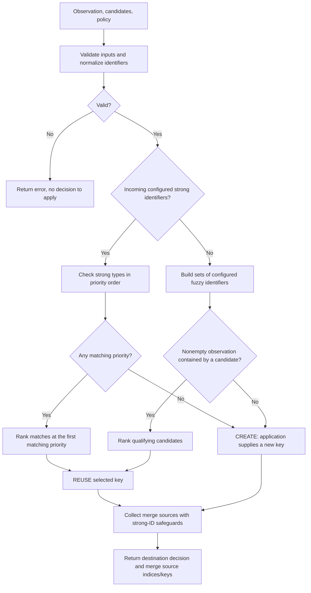

# How Asset Identity Works

Asset-identity decides whether an observation should use an existing asset key or receive a new one.
It combines identifier normalization, configurable strong-ID priority, and fuzzy set containment.
The native Go API and the GLib C API run the same algorithm.

This document explains the current library through examples. The [specifications](specs/SPEC-001-identifiers.md)
define the detailed contracts.

## 1. The decision in one example

An application supplies an observation and the existing assets it wants considered:

| Input       | Agent ID | IP         | Existing asset key |
| ----------- | -------- | ---------- | ------------------ |
| Observation | agent-42 | 192.0.2.20 | —                  |
| Candidate   | agent-42 | 192.0.2.10 | asset-A            |

The Agent ID matches, so the result is `REUSE asset-A`. The IP change does not prevent a strong match.

The library returns this decision. The application assigns or generates the key and stores its own data.
It also returns eligible existing keys to move under the destination key. The application performs those moves.

## 2. What goes into the algorithm

| Concept     | Meaning                                                                         |
| ----------- | ------------------------------------------------------------------------------- |
| Observation | The eligible active identifiers describing the newly observed asset             |
| Candidate   | An existing asset key, its eligible active identifiers, and optional `LastSeen` |
| Identifier  | A type, a value, and an optional scope                                          |
| Policy      | Ordered strong identifier types and configured fuzzy types/weights              |

One observation or candidate can contain several identifier types and several values of each type.
For example, a host may have two IP addresses, several SSH keys, and multiple TLS certificates.

The application finds candidates before calling the library. It also decides which scanner, network,
tenant, historical values, and producer data are eligible. The library compares exactly the supplied views;
it does not discover hosts, query a database, or build candidates from past observations.
You can collect candidates by any equal hostname, IP, or MAC. Supply one candidate per existing key, with its
complete eligible active identifiers, rather than only the identifier that matched the query. Otherwise containment
and strong-ID safeguards would operate on incomplete data.

### Scope is part of the identifier

A normalized identifier is compared using all three components:

```text
identifier = (type, canonical value, complete scope)
```

| Left identifier             | Right identifier           | Equal? |
| --------------------------- | -------------------------- | ------ |
| IP 192.0.2.10, network=A    | IP 192.0.2.10, network=A   | Yes    |
| IP 192.0.2.10, network=A    | IP 192.0.2.10, network=B   | No     |
| IP 192.0.2.10, absent scope | IP 192.0.2.10, empty scope | No     |

Scope names and values are exact; map order does not matter. Absent scope is not a wildcard.
Scanner/network eligibility remains application-owned even when identifiers carry scope.

## 3. Default identifier roles

`GreenboneMatchPolicy()` defines the following strong priority, highest first:

| Priority | Identifier          | Matching rule                  |
| -------- | ------------------- | ------------------------------ |
| 1        | Greenbone ID        | Any equal value                |
| 2        | Agent ID            | Any equal value                |
| 3        | Machine ID          | Any equal value                |
| 4        | BIOS UUID           | Any equal value                |
| 5        | SSH host key        | Any equal public key           |
| 6        | TLS public-key hash | Equal complete public-key sets |
| 7        | Cloud identifier    | Any equal value                |

The default fuzzy types are:

| Identifier | Weight |
| ---------- | ------ |
| MAC        | 1.0    |
| Hostname   | 0.4    |
| IP         | 0.4    |

FQDN is a supported identifier type but has no default matching role. It may be explicitly configured as strong;
fuzzy FQDN membership is currently rejected. Hostname and FQDN remain different types.

Callers may reorder, omit, or reclassify supported types. A type cannot belong to both stages.
An omitted type does not contribute to matching. Empty configuration does not restore defaults.

## 4. Normalize before comparing

Normalization makes equivalent representations comparable without changing caller-owned inputs.

| Input                                              | Canonical value used for matching      |
| -------------------------------------------------- | -------------------------------------- |
| MAC `02-AB-CD-EF-01-23`                            | `02:ab:cd:ef:01:23`                    |
| IP `2001:0DB8:0:0:0:0:0:1`                         | `2001:db8::1`                          |
| Hostname `WEB.Example.`                            | `web.example`                          |
| BIOS UUID `{00112233-4455-6677-8899-AABBCCDDEEFF}` | `00112233-4455-6677-8899-aabbccddeeff` |
| SSH `22 ecdsa-sha2-nistp256 <key>`                 | `ecdsa-sha2-nistp256 <canonical-key>`  |
| TLS `x509:<base64-DER-certificate>`                | `spki-sha256:<public-key-digest>`      |

Greenbone, agent, and cloud IDs preserve their opaque bytes, including case and whitespace.
Machine IDs require `Scope["kind"]` to select Linux machine-ID or Windows MachineGuid parsing.
Scopes are copied and preserved, rather than inferred from payloads.

### Raw SSH and TLS values

The caller may pass the SSH scanner value, including its leading port, directly. The port and optional key comment
are removed; public-key material determines equality.

For TLS, the library decodes the `x509:` certificate, extracts its exact DER SubjectPublicKeyInfo, and calculates
SHA-256 internally. Existing `spki-sha256:` values are also accepted. Callers do not need to calculate the hash.

This means:

- A renewed certificate with the same public key has the same TLS identifier, assuming the same SPKI encoding and scope.
- The same public key presented on two ports contributes one distinct TLS identifier when scopes are equal.
- A certificate with a different public key contributes a different TLS identifier.
- Issuer CN, serial number, validity dates, and whole-certificate fingerprints cannot replace the public-key input.

Certificate trust, signatures, expiry, and DNS-name agreement are not checked. Certificate subject CN/SAN names
are not automatically converted into FQDN identifiers, and there is no `tls_fqdn_cn` identifier type.

`Decide` performs normalization automatically. Structural model `Validate` methods alone do not validate payload syntax;
standalone `ValidateIdentifier`, `NormalizeIdentifier`, and `EqualIdentifiers` are available when needed.
Full format rules are in [SPEC-001B](specs/SPEC-001B-normalization.md).

## 5. Decision flow



A supplied strong identifier with no strong match leads to `CREATE`. It does not trigger fuzzy fallback.
Fuzzy matching is entered only when the observation has no identifiers belonging to the configured strong stage.

## 6. Strong matching

### First matching priority wins

Check strong types in policy order. If one type has no qualifying candidates, continue to the next type.
Stop at the first type with at least one qualifying candidate.

| Observation                          | Candidates                                 | Result under the default policy |
| ------------------------------------ | ------------------------------------------ | ------------------------------- |
| Greenbone ID G, Agent ID A           | asset-G matches G; newer asset-A matches A | REUSE asset-G                   |
| Unmatched Greenbone ID G, Agent ID A | asset-A matches A                          | REUSE asset-A                   |
| Agent ID A, changed IP               | asset-A matches A but has the old IP       | REUSE asset-A                   |
| Agent ID A, IP 192.0.2.10            | Only an IP-matching candidate              | CREATE; no fuzzy fallback       |

Other than TLS, one equal value at the winning strong type is enough. Multiple incoming values of that type
may therefore identify several qualifying candidates. The ranking below selects the destination; other records can appear in the merge plan described below.

### TLS requires exact public-key sets

TLS matching compares all distinct normalized TLS keys, including their scopes.
The following examples assume TLS is the deciding strong type:

| Observation keys | Candidate keys | TLS match?                      |
| ---------------- | -------------- | ------------------------------- |
| A, B             | A, B           | Yes                             |
| A, B             | B, A           | Yes                             |
| A, A, B          | A, B           | Yes: duplicates do not add keys |
| A, B             | A              | No: candidate is missing B      |
| A, B             | A, B, C        | No: candidate has an extra key  |
| A, B             | A, C           | No: only partial overlap        |

Keys here mean public-key identities, not certificate rows. Two certificates with the same normalized key and scope
count as one set member.

A TLS mismatch does not override an earlier strong match. It allows later configured strong types to be checked.
If no strong type matches, the result is `CREATE`, even when fuzzy identifiers overlap.
This also means a changed TLS set can still lead to `REUSE` through a matching higher-priority Agent ID, for example.

### Rank candidates at the winning priority

| Order | Rule                                                                |
| ----- | ------------------------------------------------------------------- |
| 1     | A present `LastSeen` ranks before a missing one                     |
| 2     | Newest UTC instant wins, including nanoseconds                      |
| 3     | Equal or all-missing times use the smallest asset key by byte order |

For example, two candidates matching the same Agent ID at equal times are ordered by key:
`asset-10` wins over `asset-2`. Candidate input order does not decide strong ties.

## 7. Fuzzy matching

Fuzzy matching uses only configured fuzzy types. With defaults, Greenbone/agent/machine IDs and other non-fuzzy
values do not enter the fuzzy sets. Equivalent values are deduplicated after normalization.

Let `O` be the observation's fuzzy identifier set and `C` a candidate's fuzzy set.
A candidate qualifies when `O` is nonempty and every member of `O` also occurs in `C`:

```text
O is a subset of C
```

### Candidate contains the observation

| Input             | IPs                    | Hostnames | MACs              |
| ----------------- | ---------------------- | --------- | ----------------- |
| Observation       | 192.0.2.10             | web01     | 02:ab:cd:ef:01:23 |
| Candidate asset-A | 192.0.2.10, 192.0.2.20 | web01     | 02:ab:cd:ef:01:23 |

Every observed fuzzy identifier is in asset-A, so the result is `REUSE asset-A`.
Additional candidate identifiers do not prevent fuzzy reuse.

### Observation contains the candidate

| Input             | IPs                    | Hostnames |
| ----------------- | ---------------------- | --------- |
| Observation       | 192.0.2.10, 192.0.2.20 | web01     |
| Candidate asset-A | 192.0.2.10             | web01     |

Asset-A is missing an observed IP, so it does not qualify. If no other candidate contains the entire observation,
the result is `CREATE`. Asset-A is returned as a merge source to move under the newly generated key.

### Partial overlap

| Input             | IP         | Hostname   |
| ----------------- | ---------- | ---------- |
| Observation       | 192.0.2.10 | new-server |
| Candidate asset-A | 192.0.2.10 | old-server |

The IP matches, but the hostname does not. The candidate does not contain the observation, so the result is `CREATE`.
However, if the observation contained only the matching IP, the candidate would qualify.
Caller-selected evidence and scope therefore matter even for fuzzy matching.

### Scoring and ties

The default score is:

```text
score = shared distinct MAC values      × 1.0
      + shared distinct hostname values × 0.4
      + shared distinct IP values       × 0.4
```

The implementation uses float32 arithmetic in configured member order. There is no minimum score or confidence threshold.
A partial candidate cannot qualify by obtaining a high score: containment is checked first.
All qualifying candidates contain the entire observation, so their scores are equal for that observation.

Fuzzy selection therefore uses the newest `LastSeen` at whole-second precision, keeping the first input candidate
when times tie. Missing fuzzy times compare as Unix epoch, unlike strong ranking where missing times rank last.

## 8. The returned decision

| Result                                                          | Stage  | NeedsNewKey | SelectedKey / SelectedIndex                   |
| --------------------------------------------------------------- | ------ | ----------- | --------------------------------------------- |
| Strong match                                                    | STRONG | false       | Existing key and its original candidate index |
| Strong evidence, no match                                       | STRONG | true        | Absent                                        |
| Fuzzy match                                                     | FUZZY  | false       | Existing key and its original candidate index |
| No fuzzy candidate qualifies, including empty fuzzy observation | FUZZY  | true        | Absent                                        |

The action is `REUSE` when an existing key is selected and `CREATE` when `NeedsNewKey` is true.
Go represents an absent index as nil; C uses `has_selected_index = FALSE`.

### Merge sources and the destination

`SelectedIndex` identifies the existing destination on REUSE. `MergeIndices` identifies other existing candidates
that should move to the destination. `MergeKeys` contains their corresponding keys in the same input order.
C exposes owned `merge_indices` (`GArray` of `gsize`) and `merge_keys` (`GPtrArray` of strings), including empty arrays.
Free both with the parent decision using `gvm_asset_identity_decision_free`.

For your example, hostname uses `TypeHostname`:

| Input | Identifiers | Existing key |
| ----- | ----------- | ------------ |
| Observation | IP P, hostname H, MAC M | — |
| Candidate 0 | IP P, hostname H | key-1 |
| Candidate 1 | IP P, MAC M | key-2 |

Neither candidate contains the entire observation. Both are contained by it, so the result is:

```text
Action: CREATE
NeedsNewKey: true
SelectedIndex: absent
SelectedKey: absent
MergeIndices: [0, 1]
MergeKeys: [key-1, key-2]
```

The application generates key-3, stores the observation under key-3, and moves the records belonging to key-1
and key-2 under key-3 in the same transaction. A single `SelectedIndex` cannot express these two source records.

For REUSE, the selected candidate supplies the destination view. Other candidates contained by that view can
move under its key, even if they do not overlap the incoming observation directly.

### Strong-ID safeguards

When source and destination both have configured strong IDs, they must match at the destination's winning
strong type. For a strong REUSE, this is the priority that selected the key. Otherwise it is the highest-priority
strong type present in the destination. TLS retains exact complete public-key-set equality. Lower-priority
identifier differences do not veto the winning match.

When either record lacks strong IDs, the source's complete fuzzy set must be contained by the destination's
nonempty fuzzy set. An empty source fuzzy set is contained, matching the original C containment rule.
Partial overlap does not suffice. Different strong IDs on both sides cannot be bypassed with an IP or MAC match.

A destination without strong IDs also requires the proposed strong-ID sources to be compatible with each other.
Compare each pair at the highest-priority strong type present in either source, retaining exact TLS set equality.
If a pair is incompatible, leave both records under their existing keys. Input order does not choose a winner;
contained records without strong IDs can still move. For example, an incoming IP/hostname/MAC observation cannot
combine one candidate with Agent ID A and another with Agent ID B. If neither contains the full observation,
create a new key and leave both strong-ID candidates separate.

The reverse case is supported: an incoming record with Agent ID A plus IP/hostname/MAC creates a new key if no
existing candidate matches its strong IDs. Existing records without strong IDs can move under that new key when
their full fuzzy sets are contained by the incoming record. If an existing strong-ID candidate matches, reuse its
key instead and evaluate merge sources against that selected candidate's view.

For example, matching Agent IDs can combine records despite an IP change; different Agent IDs cannot merge
through fuzzy containment when Agent ID is the deciding type. TLS `{A,B}` and `{A}` cannot merge through the
TLS rule. A higher-priority matching Agent ID still takes precedence, as it does for key selection.

Invalid policy, malformed identifiers, empty/duplicate candidate keys, or out-of-range candidate timestamps return
an error. Invalid input is not interpreted as `CREATE`. Validation covers supplied candidates even when they would
not win; unsupported types are not silently skipped. Present timestamps must be within UTC years 1–9999.

## 9. Calling from Go or C

Go calls:

```go
decision, err := identity.Decide(observation, candidates, identity.GreenboneMatchPolicy())
```

C calls:

```c
gvm_asset_identity_decide(observation, candidates, policy, &decision, &error);
```

C callers can pass raw `22 <algorithm> <key>` and `x509:<base64-DER-certificate>` values in identifiers on either side.
The constructor copies the supplied value; parsing occurs during `gvm_asset_identity_decide`.
A malformed value produces `GVM_ASSET_IDENTITY_ERROR_INVALID_INPUT` rather than a partial result.
Use the matching free functions for owned C objects; `decide` borrows inputs and returns an independent result.
See the [README](../README.md#c-build-test-and-install) for a complete build and usage example.

## 10. Applying the result

The application handles the decision conceptually as follows:

```text
if the call returned an error:
    do not apply a decision
else if action is REUSE:
    use the selected existing asset key
else if action is CREATE:
    generate a new asset key

in one transaction:
    store the observation using that destination key
    move every key listed in MergeKeys to the destination key
```

The library returns the plan; it does not update prior observations, execute key moves, count assets, prune history, or infer a current view
from accumulated history. Changes to IPs or other identifiers only affect the next call through the inputs supplied by
the application. No key is generated inside `Decide`.

## 11. Implementation and further reading

| Topic                                          | Source or contract                                       |
| ---------------------------------------------- | -------------------------------------------------------- |
| Input validation and decision assembly         | [reconciliation.go](../identity/reconciliation.go)       |
| Strong matching, TLS set equality, and ranking | [matching.go](../identity/matching.go)                   |
| Merge eligibility and source collection        | [merging.go](../identity/merging.go)                     |
| Fuzzy containment and scoring                  | [fuzzy.go](../identity/fuzzy.go)                         |
| Default policy and policy validation           | [policy.go](../identity/policy.go)                       |
| TLS certificate parsing                        | [normalization_tls.go](../identity/normalization_tls.go) |
| SSH key parsing                                | [normalization_ssh.go](../identity/normalization_ssh.go) |
| C API and ownership                            | [Public header](../include/gvm_asset_identity.h)         |
| Detailed reconciliation contract               | [SPEC-002](specs/SPEC-002-reconciliation.md)             |
