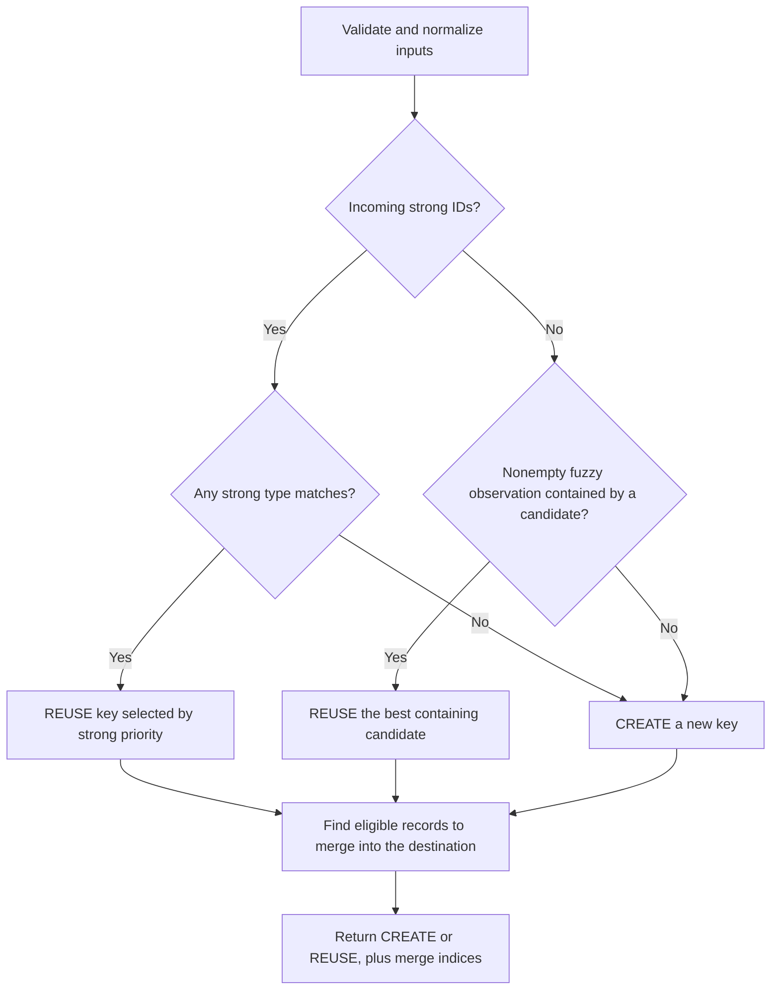

# How Asset Identity Works

Asset-identity decides whether an observation should use an existing asset key or receive a new one. It combines
identifier normalization, configurable strong-ID priority, and fuzzy set containment. The native Go API and the GLib C
API run the same algorithm.

This document explains the current library through examples. The [specifications](specs/SPEC-001-identifiers.md)
define the detailed contracts.

## 1. The decision in one example

An application supplies an observation and the existing assets it wants considered:

| Input       | Agent ID | IP         | Existing asset key |
|-------------|----------|------------|--------------------|
| Observation | agent-42 | 192.0.2.20 | —                  |
| Candidate   | agent-42 | 192.0.2.10 | asset-A            |

The Agent ID matches, so the result is `REUSE asset-A`. The IP change does not prevent a strong match.

The library returns this decision. The application assigns or generates the key and stores its own data. It also returns
eligible existing keys to move under the destination key. The application performs those moves.

## 2. What goes into the algorithm

| Concept     | Meaning                                                                         |
|-------------|---------------------------------------------------------------------------------|
| Observation | The eligible active identifiers describing the newly observed asset             |
| Candidate   | An existing asset key, its eligible active identifiers, and optional `LastSeen` |
| Identifier  | A type, a value, and an optional scope                                          |
| Policy      | Ordered strong identifier types and configured fuzzy types/weights              |

One observation or candidate can contain several identifier types and several values of each type. For example, a host
may have two IP addresses, several SSH keys, and multiple TLS certificates.

The application finds candidates before calling the library. It also decides which scanner, network, tenant, historical
values, and producer data are eligible. The library compares exactly the supplied views; it does not discover hosts,
query a database, or build candidates from past observations. You can collect candidates by any equal hostname, IP, or
MAC. Supply one candidate per existing key, with its complete eligible active identifiers, rather than only the
identifier that matched the query. Otherwise containment and strong-ID safeguards would operate on incomplete data.

### Scope is part of the identifier

A normalized identifier is compared using all three components:

```text
identifier = (type, canonical value, complete scope)
```

| Left identifier             | Right identifier           | Equal? |
|-----------------------------|----------------------------|--------|
| IP 192.0.2.10, network=A    | IP 192.0.2.10, network=A   | Yes    |
| IP 192.0.2.10, network=A    | IP 192.0.2.10, network=B   | No     |
| IP 192.0.2.10, absent scope | IP 192.0.2.10, empty scope | No     |

Scope names and values are exact; map order does not matter. Absent scope is not a wildcard. Scanner/network eligibility
remains application-owned even when identifiers carry scope.

## 3. Default identifier roles

`GreenboneMatchPolicy()` defines the following strong priority, highest first:

| Priority | Identifier          | Matching rule                  |
|----------|---------------------|--------------------------------|
| 1        | Greenbone ID        | Any equal value                |
| 2        | Agent ID            | Any equal value                |
| 3        | Machine ID          | Any equal value                |
| 4        | BIOS UUID           | Any equal value                |
| 5        | SSH host key        | Any equal public key           |
| 6        | TLS public-key hash | Equal complete public-key sets |
| 7        | Cloud identifier    | Any equal value                |

The default fuzzy types are:

| Identifier | Weight |
|------------|--------|
| MAC        | 1.0    |
| Hostname   | 0.4    |
| IP         | 0.4    |
| FQDN       | 0.4    |

FQDN is weak evidence because names can be reassigned or shared. Compare the full normalized name:
`SERVER.EXAMPLE.COM.` and `server.example.com` match as FQDNs. Hostname and FQDN remain different types;
`hostname:server` does not match `fqdn:server.example.com`. FQDN participates in fuzzy containment and merge eligibility
alongside the other configured fuzzy types.

Callers may reorder, omit, or reclassify supported types. A type cannot belong to both stages. An omitted type does not
contribute to matching. Empty configuration does not restore defaults.

## 4. Normalize before comparing

Normalization makes equivalent representations comparable without changing caller-owned inputs.

| Input                                              | Canonical value used for matching      |
|----------------------------------------------------|----------------------------------------|
| MAC `02-AB-CD-EF-01-23`                            | `02:ab:cd:ef:01:23`                    |
| IP `2001:0DB8:0:0:0:0:0:1`                         | `2001:db8::1`                          |
| Hostname `WEB.Example.`                            | `web.example`                          |
| BIOS UUID `{00112233-4455-6677-8899-AABBCCDDEEFF}` | `00112233-4455-6677-8899-aabbccddeeff` |
| SSH `22 ecdsa-sha2-nistp256 <key>`                 | `ecdsa-sha2-nistp256 <canonical-key>`  |
| TLS `x509:<base64-DER-certificate>`                | `spki-sha256:<public-key-digest>`      |

Greenbone, agent, and cloud IDs preserve their opaque bytes, including case and whitespace. Machine IDs require
`Scope["kind"]` to select Linux machine-ID or Windows MachineGuid parsing. Scopes are copied and preserved, rather than
inferred from payloads.

### Raw SSH and TLS values

The caller may pass the SSH scanner value, including its leading port, directly. The port and optional key comment are
removed; public-key material determines equality.

For TLS, the library decodes the `x509:` certificate, extracts its exact DER SubjectPublicKeyInfo, and calculates
SHA-256 internally. Existing `spki-sha256:` values are also accepted. Callers do not need to calculate the hash.

This means:

- A renewed certificate with the same public key has the same TLS identifier, assuming the same SPKI encoding and scope.
- The same public key presented on two ports contributes one distinct TLS identifier when scopes are equal.
- A certificate with a different public key contributes a different TLS identifier.
- Issuer CN, serial number, validity dates, and whole-certificate fingerprints cannot replace the public-key input.

Certificate trust, signatures, expiry, and DNS-name agreement are not checked. Certificate subject CN/SAN names are not
automatically converted into FQDN identifiers, and there is no `tls_fqdn_cn` identifier type.

`Decide` performs normalization automatically. Structural model `Validate` methods alone do not validate payload syntax;
standalone `ValidateIdentifier`, `NormalizeIdentifier`, and `EqualIdentifiers` are available when needed. Full format
rules are in [SPEC-001B](specs/SPEC-001B-normalization.md).

## 5. Four steps

The algorithm first chooses the destination key, then finds existing records that can move under it.

1. **Look for a strong match.** Try strong identifier types in priority order. The first type with a match selects an
   existing key: `REUSE`.
2. **Create if supplied strong IDs do not match.** If the observation has strong IDs but none matches, return `CREATE`.
   An IP, hostname, or MAC match cannot select an existing key in this case.
3. **Use fuzzy containment when no strong IDs were supplied.** Reuse a candidate containing every incoming fuzzy
   identifier. If none qualifies, return `CREATE`.
4. **Find records that can join the destination.** Apply the strong-ID safeguards and containment rules below. Return
   their indices in the merge plan.

Here, “strong” and “fuzzy” mean the types enabled in the supplied policy. The defaults are listed above.
`CREATE` requests a new key from the application; the library does not generate one.



Invalid input returns an error before a decision can be applied.

## 6. Choose a key using strong IDs

### Try identifier types in order

Try the highest-priority strong type first. If it matches nobody, try the next type. As soon as a type matches, choose
among its matching candidates and stop checking other types.

For example, Greenbone ID has higher priority than Agent ID:

| Incoming observation       | Existing candidates                        | Destination   |
|----------------------------|--------------------------------------------|---------------|
| Greenbone ID G, Agent ID A | asset-G matches G; newer asset-A matches A | REUSE asset-G |
| Greenbone ID G, Agent ID A | Nobody matches G; asset-A matches A        | REUSE asset-A |
| Agent ID A, changed IP     | asset-A matches A and has the old IP       | REUSE asset-A |
| Agent ID A, IP P           | Nobody matches A; asset-B matches only P   | CREATE        |

**Priority comes before recency.** A newer Agent-ID match cannot beat a Greenbone-ID match. An unmatched Greenbone ID
still allows an Agent-ID match to be considered. If no strong type matches, create a new key; do not select an existing
key using fuzzy identifiers. Merge planning still runs afterward, so contained records without strong IDs may join the
new key.

### If several candidates match the same strong type

Except for TLS, one equal value of that type is enough. An observation with Agent IDs A and B can therefore match one
candidate through A and another through B.

Choose the candidate with the newest `LastSeen`. Present timestamps rank before missing timestamps; equal or all-missing
times use the smallest asset key in byte order. Strong timestamps include nanoseconds. This chooses one destination. The
separate merge rules decide whether other records can join it.

### TLS compares the complete public-key set

When TLS is the deciding type, all distinct normalized TLS keys and their scopes must be equal. Order and duplicates do
not matter:

| Incoming keys | Candidate keys | TLS match? |
|---------------|----------------|------------|
| A, B          | B, A           | Yes        |
| A, A, B       | A, B           | Yes        |
| A, B          | A              | No         |
| A, B          | A, B, C        | No         |
| A, B          | A, C           | No         |

These are public-key identities, not certificate rows. The same key and scope count once. If TLS does not match,
continue to later strong types. A higher-priority match, such as Agent ID, already decides the destination even if TLS
keys differ.

## 7. Choose a key when no strong IDs were supplied

Compare only the configured fuzzy identifiers: MAC, hostname, and IP by default. Normalize them and ignore duplicate
values. Type and complete scope remain part of each identifier.

**Reuse requires a candidate to contain every incoming fuzzy identifier.**
Additional candidate identifiers are allowed. An observation with no fuzzy identifiers returns `CREATE`.

| Incoming fuzzy identifiers | Candidate fuzzy identifiers | Destination                                           |
|----------------------------|-----------------------------|-------------------------------------------------------|
| IP P, hostname H           | IP P, hostname H, MAC M     | REUSE the candidate                                   |
| IP P, hostname H, MAC M    | IP P, hostname H            | CREATE if no other candidate contains the observation |
| IP P, hostname H1          | IP P, hostname H2           | CREATE if no other candidate contains the observation |

Matching only the IP is insufficient when the observation also supplies a different hostname. In the second row, the
narrower candidate may still join the new key during merge planning.

If several candidates contain the full observation, choose the newest `LastSeen` at whole-second precision. Equal times
keep the first candidate in the supplied array. Missing fuzzy timestamps compare as Unix epoch. The weighted score does
not allow partial matches: containment is required first, so qualifying candidates have equal scores. Arithmetic details
are in [SPEC-002](specs/SPEC-002-reconciliation.md#fuzzy-matching).

## 8. The returned decision

### The destination key

| Action | NeedsNewKey | SelectedKey / SelectedIndex                               |
|--------|-------------|-----------------------------------------------------------|
| REUSE  | false       | Existing destination key and its original candidate index |
| CREATE | true        | Absent; the application generates the destination key     |

`Stage` tells you whether strong or fuzzy matching chose the destination. Go represents an absent index as nil; C uses
`has_selected_index = FALSE`.

### The records that can join it

`MergeIndices` lists positions in the original candidate array. Retrieve each candidate from that array to find its
identifiers and asset key. The selected destination is excluded. An empty list means there are no existing records to
move. The library does not return copies of candidates or individual historical observations.

Use the selected candidate's identifiers as the destination view on `REUSE`. Use the incoming observation's identifiers
on `CREATE`. Then apply these rules:

| Source and destination  | Requirement to merge                                                                  |
|-------------------------|---------------------------------------------------------------------------------------|
| Both have strong IDs    | Match at the destination's deciding strong type; TLS requires equal complete key sets |
| Either lacks strong IDs | Every source fuzzy identifier must occur in the destination's nonempty fuzzy set      |

For a strong `REUSE`, the deciding type is the one that selected the key. Otherwise, use the highest-priority strong
type present in the destination. Other identifier types do not veto a match at that deciding type. An empty source fuzzy
set is contained, matching the original C containment rule.

If the destination has no strong IDs, also check the proposed strong-ID sources against each other. Compare each pair at
the highest-priority strong type present in either source. Leave both members of an incompatible pair separate;
candidate order does not choose a winner. Contained weak records remain eligible.

### Example: combine two partial records under a new key

Here hostname uses `TypeHostname`, and none of the records has strong IDs:

| Input       | Identifiers             | Existing key |
|-------------|-------------------------|--------------|
| Observation | IP P, hostname H, MAC M | —            |
| Candidate 0 | IP P, hostname H        | key-1        |
| Candidate 1 | IP P, MAC M             | key-2        |

Neither candidate contains the full observation, so create a new key. Both candidates are contained by the observation,
so both can move under it:

```text
Action: CREATE
NeedsNewKey: true
SelectedIndex: absent
SelectedKey: absent
MergeIndices: [0, 1]
```

The application generates key-3, stores the observation under key-3, and moves the records belonging to key-1 and key-2
under key-3 in one transaction. `SelectedIndex` identifies a reused destination;
`MergeIndices` identifies the existing records to move.

### Examples with strong IDs

- **Incoming strong ID, existing weak records:** add Agent ID A to the observation above. If no existing strong ID
  matches, still return `CREATE` and merge both contained weak records into the new key.
- **Weak observation, conflicting strong records:** give candidate 0 Agent ID A and candidate 1 Agent ID B. Return
  `CREATE` and leave both existing records under their own keys.
- **Same deciding strong ID:** records matching the destination's deciding Agent ID can merge despite changed IPs.
  Different Agent IDs cannot be bypassed through fuzzy containment when Agent ID decides.
- **TLS decides:** TLS sets `{A,B}` and `{A}` cannot merge through TLS. A higher-priority matching Agent ID still takes
  precedence.

Go callers retrieve the supplied candidates directly:

```go
for _, index := range decision.MergeIndices {
source := candidates[index]
// Move source.AssetKey to the destination key in the application's transaction.
}
```

C callers use the same indices with their original `GPtrArray`:

```c
for (guint i = 0; i < decision->merge_indices->len; i++) {
    gsize index = g_array_index(decision->merge_indices, gsize, i);
    const gvm_asset_identity_candidate_t *source = g_ptr_array_index(candidates, index);
    /* Move source->asset_key to the destination key in the application's transaction. */
}
```

Keep the original candidate array available while resolving indices. The decision owns its C `merge_indices`
array, including when empty. Release it with the parent using `gvm_asset_identity_decision_free`.

Invalid policy, malformed identifiers, empty/duplicate candidate keys, or out-of-range timestamps return an error.
Invalid input is not interpreted as `CREATE`; validation covers every supplied candidate.

## 9. Calling from Go or C

Go calls:

```go
decision, err := identity.Decide(observation, candidates, identity.GreenboneMatchPolicy())
```

C calls:

```c
gvm_asset_identity_decide(observation, candidates, policy, &decision, &error);
```

C callers can pass raw `22 <algorithm> <key>` and `x509:<base64-DER-certificate>` values in identifiers on either side.
The constructor copies the supplied value; parsing occurs during `gvm_asset_identity_decide`. A malformed value produces
`GVM_ASSET_IDENTITY_ERROR_INVALID_INPUT` rather than a partial result. Use the matching free functions for owned C
objects; `decide` borrows inputs and returns an independent result. See
the [README](../README.md#c-build-test-and-install) for a complete build and usage example.

## 10. Applying the result

The application handles the decision conceptually as follows:

```text
if the call returned an error:
    do not apply a decision
else if action is REUSE:
    use the selected existing asset key
else if action is CREATE:
    generate a new asset key

in one transaction:
    store the observation using that destination key
    for each index in MergeIndices:
        move candidates[index].AssetKey to the destination key
```

The library returns the plan; the application performs the database updates. The library does not count assets, prune
history, or infer a current view from accumulated history. Changes to IPs or other identifiers only affect the next call
through the inputs supplied by the application. No key is generated inside `Decide`.

## 11. Implementation and further reading

| Topic                                          | Source or contract                                       |
|------------------------------------------------|----------------------------------------------------------|
| Input validation and decision assembly         | [reconciliation.go](../identity/reconciliation.go)       |
| Strong matching, TLS set equality, and ranking | [matching.go](../identity/matching.go)                   |
| Merge eligibility and source collection        | [merging.go](../identity/merging.go)                     |
| Fuzzy containment and scoring                  | [fuzzy.go](../identity/fuzzy.go)                         |
| Default policy and policy validation           | [policy.go](../identity/policy.go)                       |
| TLS certificate parsing                        | [normalization_tls.go](../identity/normalization_tls.go) |
| SSH key parsing                                | [normalization_ssh.go](../identity/normalization_ssh.go) |
| C API and ownership                            | [Public header](../include/gvm_asset_identity.h)         |
| Detailed reconciliation contract               | [SPEC-002](specs/SPEC-002-reconciliation.md)             |
